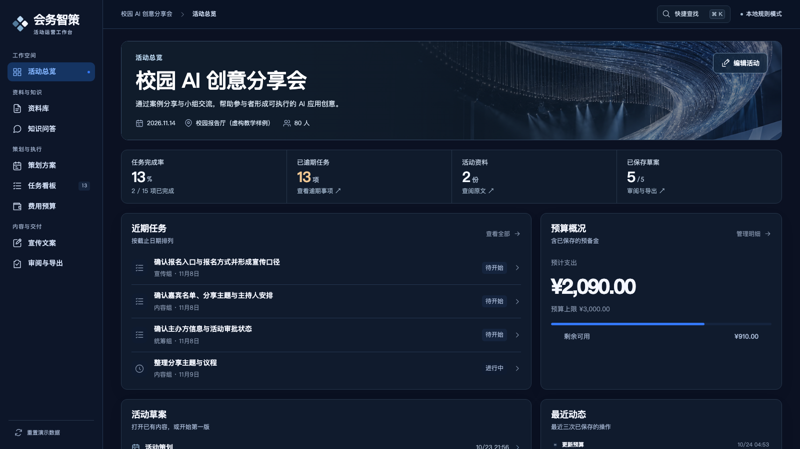

# 会务智策 · AI 活动运营工作台

给校园社团和小型活动团队使用的桌面网页应用。筹备一场分享会时，负责人可以导入场地须知，追问“清场需要预留多久”，点开引用核对原文，再据此安排议程、分配任务和核算预算。



## 在本机运行

安装 Python 3.9 或更新版本。在仓库根目录执行以下命令。前端已经构建，可以直接运行。

```sh
cd 核心代码/组员1-组员2-组员3-核心代码
python3 server.py
```

Windows 可用 `py -3 server.py`。启动后打开[产品首页](http://127.0.0.1:8765)或[活动总览](http://127.0.0.1:8765/#overview)。首次运行会载入一组虚构活动资料、任务和预算。数据保存在本机 SQLite 中。

## 能做什么

| 筹备环节 | 工作台操作 |
| --- | --- |
| 确定活动要求 | 编辑活动目标、时间、场地、人数和预算上限。在总览查看到期任务与已保存的草案。 |
| 核对资料 | 导入 TXT 或 Markdown，按名称、正文或负责人快捷查找相关资料和任务。问答保留引用，可打开全文查看上下文。 |
| 安排执行 | 根据项目与资料起草策划方案、日程和风险预案。按负责人、截止日期和状态筛选任务，推进看板。 |
| 控制费用 | 逐项编辑数量、单价和预备金比例，预览总额与超支。后端使用十进制金额核算。 |
| 形成交付 | 起草宣传文案，审阅方案，导出 Markdown、JSON 项目快照和 CSV 预算明细。 |

八个业务页面覆盖十一项功能。桌面快捷键 `⌘ K` 或 `Ctrl K` 可以定位功能、资料原文和任务。策划草案支持宽屏阅读。首页的全屏影像与活动卡使用 AI 生成的概念场景。[查看产品首页截图](docs/homepage.png)

## 接入大模型

从核心代码目录的 `.env.example` 复制一份 `.env`，填写自己的兼容接口地址、模型名和密钥。未配置接口时，可在本地检索资料并体验规则生成。接入模型后，相关资料片段会发送至配置的服务商，页面会标出回答和草案来源。接口失败会显示错误。详见[运行及模型配置说明](核心代码/组员1-组员2-组员3-核心代码/README.md)。

## 课程材料

| 文件夹 | 内容 |
| --- | --- |
| [核心代码](核心代码/组员1-组员2-组员3-核心代码) | React、TypeScript、Vite 前端与 Python、SQLite 后端，含构建文件、测试和使用说明 |
| [项目报告](项目报告/组员1-组员2-组员3-项目报告.docx) | 15 页 Word，沿用课程模板，成员与分工留空 |
| [PPT](PPT/组员1-组员2-组员3-PPT.pptx) | 15 页可编辑演示文稿 |
| [演示视频](demo视频/组员1-组员2-组员3-demo.mp4) | 1 分 42 秒桌面实操，含中文字幕及[时间索引](demo视频/组员1-组员2-组员3-demo说明.txt) |

## 验证范围

本版通过 72 项后端检查、13 项业务浏览器检查、8 项首页检查、11 项桌面操作和 6 项并发与重试检查。浏览器回归使用隔离的本地规则服务。真实接口的历史案例单独保留了模型误读和修订前后的输出。应用面向单机活动筹备，模型草案需由负责人核对后使用。[测试记录](核心代码/组员1-组员2-组员3-核心代码/verification) · [真实模型案例](核心代码/组员1-组员2-组员3-核心代码/examples/真实模型案例记录.json)
