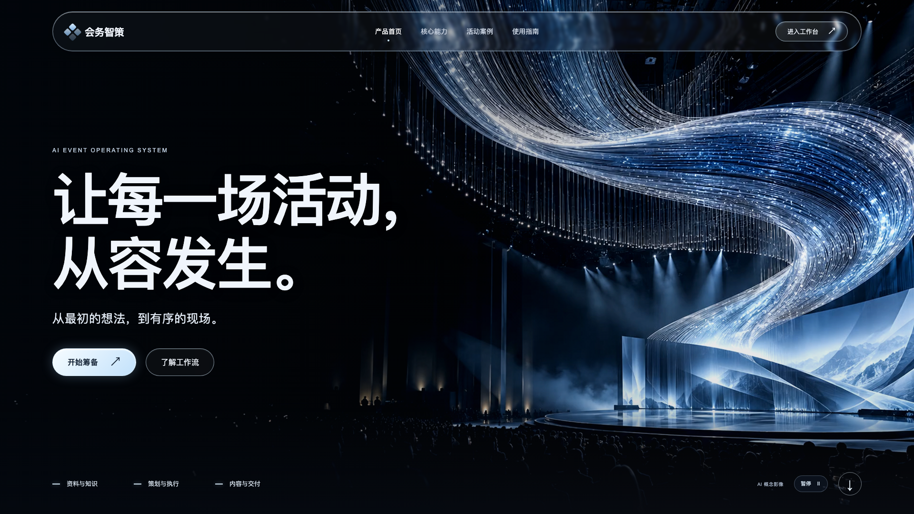

# 会务智策 · AI 活动运营工作台

面向校园社团和小型活动组织者的课程综合项目。使用 React、TypeScript、Vite、Python 和 SQLite，把资料、生成、任务与预算放在同一个工作台。



## 功能

活动信息管理、资料库、带引用的资料问答、活动策划、日程编排、风险预案、任务看板、费用预算、宣传文案、方案审阅和成果导出，共十一项业务功能。另含全屏动态展示首页、玻璃质感导航和响应式布局。

大模型负责问答、起草与审阅，预算由程序使用 Decimal 核算。生成内容需人工核对；自带活动与资料均为虚构教学样例，AI 概念图片不代表真实活动记录。

## 快速运行

需要 Python 3.9 或更新版本。在仓库根目录运行：

```sh
cd 核心代码/组员1-组员2-组员3-核心代码
python3 server.py
```

Windows 可使用 `py -3 server.py`。打开 http://127.0.0.1:8765 ，从首页进入工作台；直接访问 `/#overview` 可进入业务界面。

静态前端已构建，运行不需要 Node.js。修改前端时在 `frontend` 目录执行 `npm ci` 和 `npm run build`。

## 模型配置

参照核心代码内的 `.env.example` 与 README 配置自己的 OpenAI 兼容接口。密钥只由后端读取，本仓库不含真实密钥或个人数据库。未配置接口时显示规则演示；真实模型请求失败会明确显示错误。

## 文件结构

- `核心代码/`：前后端源码、构建产物、测试、案例与运行说明。
- `项目报告/`：按提供的 Word 模板编写的 15 页报告，成员与分工留空。
- `PPT/`：15 页课程展示 PPT。
- `demo视频/`：约 1 分 56 秒的实际界面演示及时间索引。
- `大模型项目报告模板.docx`：原始报告模板。

文件名中的成员姓名暂用“组员1-组员2-组员3”占位。

## 验证与限制

本轮记录包含 65 项后端检查、13 项业务浏览器检查、8 项首页检查通过。真实模型案例保留误读和提示修订观察，功能检查不代表模型总体准确率或生产就绪。详细记录见核心代码的 `verification/` 与 `examples/`。

当前为单机课程原型，尚未实现生产级账户权限与部署架构。界面组件的第三方说明见 `frontend/THIRD_PARTY_NOTICES.txt`、`frontend/licenses/`，生成素材来源见 `frontend/MEDIA_PROVENANCE.md`。
